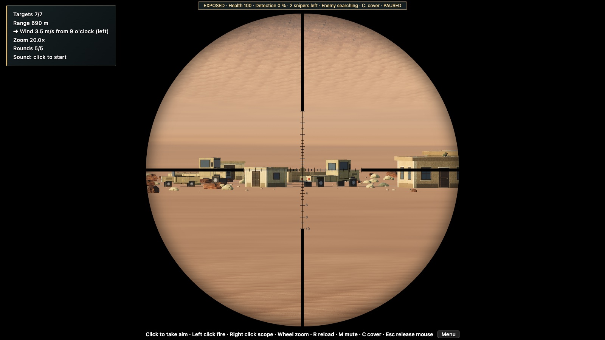

# Longshot Ballistics

**A long-range sniper simulator that runs in the browser. Every shot is a real ballistic solution.**

Read the wind, hold over for drop and make the shot at 300 to 1,500 m. Every bullet is flown through a G7 drag model and the air of the map you're on. It is not a hitscan ray. Enemy snipers are hunting you too, so stay in cover and keep your shots few.


| Through the scope | Training aids |
|---|---|
|  |  |
| **Green valley**, mountain position | **Arctic**, suppressed .338 |
|  |  |

## Features

- **Real external ballistics**
  - A point-mass trajectory with G7 drag, integrated with RK4.
  - Air density and the speed of sound come from each map's temperature and pressure.
  - Bullet drop, wind drift and time of flight all emerge from the simulation; nothing is faked.
  - Checked against [js-ballistics](https://www.npmjs.com/package/js-ballistics) in the test suite.
- **Two rifles**
  - .308 Win: G7 BC 0.243 at 790 m/s.
  - .338 Lapua: G7 BC 0.322 at 900 m/s.
  - Each has an optional suppressor: no muzzle flash, a quieter report and slower detection.
- **Optional ghillie suit** (a switch in the menu): hard for the enemy to spot while you hold fire, and your sleeves wear the map's camouflage. Your shots still give you away.
- **Variable-power scope** with a mil reticle, mouse-wheel zoom and a moving bolt.
  - Sound travels at the speed of sound: at long range you hear the impact well after the shot.
- **Enemy counter-snipers**
  - They build up detection every time you fire.
  - Once they find you, they shoot back and call in bombardments.
  - Press **C** to duck into cover.
- **Mission setup menu**
  - Three themes: desert, arctic and green valley.
  - A range band from 100 to 1,500 m.
  - 1 to 10 soldiers, vehicle targets, and 0 to 3 enemy snipers.
  - Wind speed and clock direction.
  - Firing position: valley floor, ridge or mountain top.
  - Density of buildings and scenery vehicles.
  - Every mission is a shareable URL.
- **Optional training aids** (toggled with T, A and P): a live trajectory arc, an aim-point marker, and a spotter who calls the hold in mils.
- **Realistic rendering**
  - HDRI skies with image-based lighting and a triplanar PBR terrain.
  - Baked sun and ambient occlusion, plus instanced vegetation.
  - Bloom and colour grading.
  - Real recorded sounds.
- **Runs on modest GPUs**
  - Quality levels and dynamic resolution.
  - About 120 draw calls in the busiest mission.


## Quick start

You need Node 22 or later.

```bash
git clone https://github.com/Anassedemnati/longshot-ballistics.git
cd longshot-ballistics
npm install
npm run dev
```

Open the URL Vite prints (usually http://localhost:5173), set up a mission and press **Start mission**.

## Controls

| Input | Action |
|---|---|
| Click | Take aim (locks the mouse) |
| Left click | Fire |
| Right click | Scope in / out |
| Mouse wheel | Zoom the scope |
| R | Reload |
| C | Duck into cover / come back up |
| T / A / P | Trajectory / aim marker / spotter (when training aids are on) |
| M | Mute |
| Esc | Release the mouse |

## URL options

| Parameter | Effect |
|---|---|
| `?m=v3.…` | A full mission, as written by the menu (the last field is the ghillie-suit flag). Copy it to share a mission. Older `v2.…` and `v1.…` links still open, with the newer options off. |
| `?quality=auto\|high\|medium\|low` | Render quality. `auto` (the default) is `medium` plus dynamic resolution. |
| `?post=low` | The cheapest post-processing: no bloom, no MSAA. |
| `?debug=1` | Exposes `window.__game`: `aimAt`, `fire`, `toggleScope`, `zoom`, `state()` and more. Used by the tests. |

## Development

```bash
npm test         # unit tests (Vitest): ballistics, mission logic, encounter rules, models
npm run build    # type-check and production build into dist/
npm run smoke    # build, then drive the game in headless Chrome and check it end to end
```

`npm run smoke` needs a local Google Chrome; it drives it through `playwright-core`.

### Project layout

| Folder | What lives there |
|---|---|
| `src/ballistics/` | G7 drag table, atmosphere, RK4 integrator, rifle data and trajectory solver. Pure TypeScript, no three.js. |
| `src/game/` | Weapon state, bullets in flight, hit tests, rangefinder, aim assists, the enemy-sniper encounter. |
| `src/mission/` | Mission config and URL codec, seeded layout of targets and props, the game loop (`run.ts`). |
| `src/scene/` | Terrain and its material, HDRI sky, post-processing, vegetation, buildings, vehicles, soldiers. |
| `src/player/` | First-person view, input, scope reticle and the procedural rifle model. |
| `src/audio/` | Web Audio engine, recorded clips and sound-delay maths. |
| `src/ui/` | Mission menu, HUD, threat bar, results screen. |
| `src/fx/` | Dust, sparks and smoke at impacts. |
| `tests/` | Vitest suites, mirroring `src/`. |
| `scripts/` | The headless smoke test and visual-check tools. |

Gameplay rules, terrain and layout are seeded and pure, so they unit-test in Node without WebGL.

## Contributing

Issues and pull requests are welcome. Some ideas:
- more scenarios (convoy ambush, high-value target, defend a position);
- animated soldier and vehicle models;
- spin drift and Coriolis;
- moving targets;
- mobile and touch controls.

Run `npm test` and `npm run smoke` before you open a PR.

## Credits

- **Textures, HDRI skies and 3D models:** [Poly Haven](https://polyhaven.com), CC0. See [`public/assets/CREDITS.md`](public/assets/CREDITS.md).
- **Sounds:** the Free Firearm Sound Library and freesound.org contributors, all CC0. See [`public/sounds/CREDITS.md`](public/sounds/CREDITS.md).
- **AI-generated images:** the menu artwork and the rifle reference sheet. Their prompts are stored next to the files.
- **Libraries:** [three.js](https://threejs.org), [Vite](https://vite.dev) and [Vitest](https://vitest.dev).

## License

[MIT](LICENSE)
