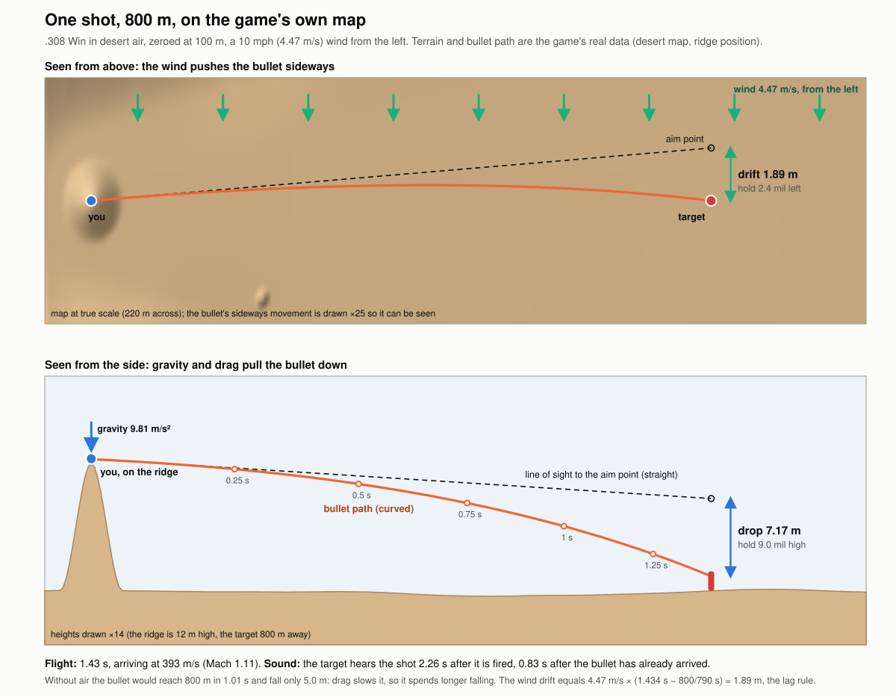
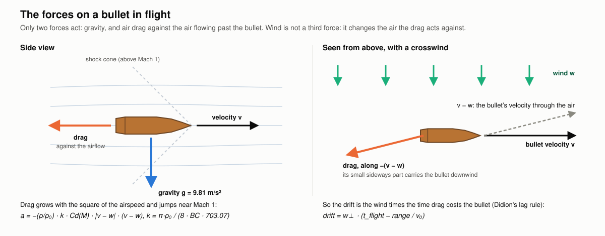
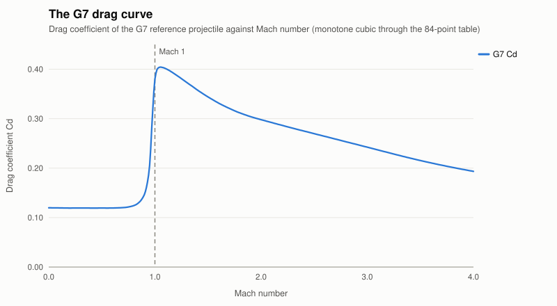
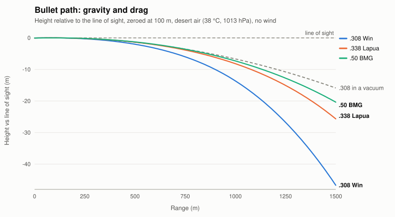
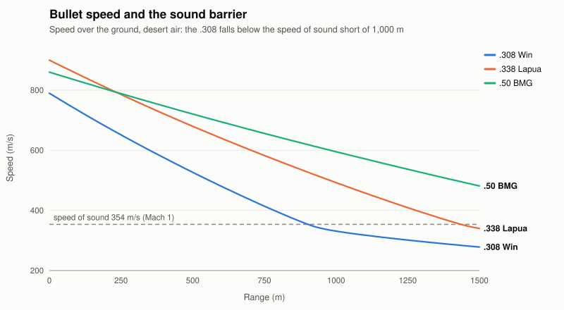
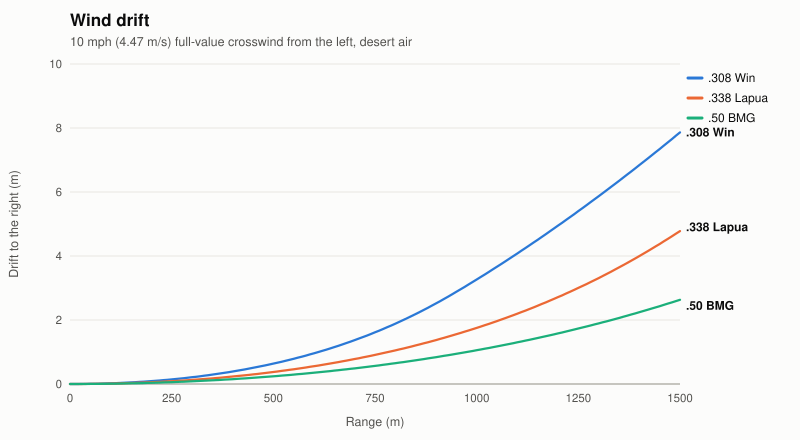
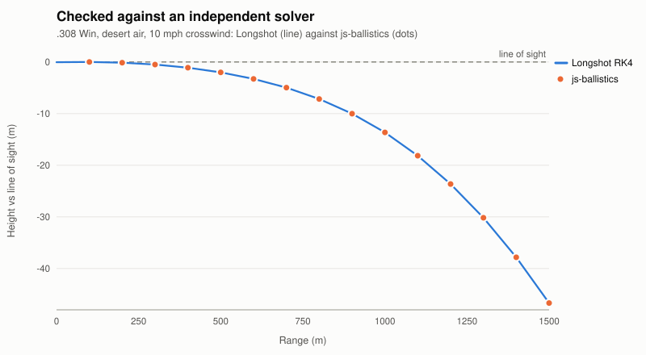

# Longshot Ballistics

**A long-range sniper simulator that runs in the browser. Every shot is a real ballistic solution.**

Read the wind, hold over for drop and make the shot at 300 to 1,500 m. Every bullet is flown through a G7 drag model and the air of the map you're on. It is not a hitscan ray. And the other side shoots back: a squad that runs for cover, returns fire and calls in mortars, and enemy snipers who spot you for them. Hunt a colonel through his bodyguards, take on a guarded military base, and pick from seven calibres up to .50 BMG.


| Through the 25x scope | Training aids |
|---|---|
|  |  |
| **Green valley**, mountain position | **Arctic**, suppressed .338 |
|  |  |

## Soldiers that fight back

Fire your first shot and the squad comes alive. They crouch, turn toward the sound and sprint for cover:


From behind walls and vehicles they rise, shoulder their rifles, fire a burst and drop back down:


Through your scope you see the muzzle flash of the man who is shooting at you:


- **They have to find you first.** Each of your shots tells them a little more (less with a suppressor or a ghillie suit), and so does every bullet that cracks past one of them and every man that goes down. At first their bursts land far away; once they have you, they land close and hurt while you are exposed.
- **An enemy sniper who has you in his scope calls your position to them.** Take him out first.
- **They move.** After a near miss, when a friend close by goes down, or just after a while in one spot, they sprint to new cover, so you have to hunt them.
- **Mortars.** Once they have you well enough they call them in: you get a four-second warning to get into cover (**C**).
- Switch it off in the menu for a classic static range; the **Soldiers** slider sets how many there are (1 to 10).


## Hits that look like hits

Bodies are not planks that tip over. A hit soldier goes limp: a Verlet ragdoll on his skeleton, pushed by the bullet, folds at the knees and waist and settles on the real terrain. Where you hit him decides how he falls (a head shot drops him on the spot, a chest shot staggers him back, a leg shot drops him onto that side), and a man hit at a sprint tumbles forward. The bullet goes through: a puff at the entry, a mist out of the far side, and the round flies on, slower, to kick up dust behind him.


## High-value target

A mission type of its own: take down one officer before he gets away. The colonel wears a red beret and no helmet, so you can pick him out through the scope. He walks his compound with his hands behind his back, stops to talk to his men and heads for his jeep, so you have to lead him. Two to four bodyguards in black keep close to him, and his squad stands around.

Once they are alarmed, the guards close around him and rush him, crouching, to the jeep or a building. If they know which side the shot came from, they form a wall on that side. You have 15 to 30 s, depending on range, before he is gone.
- A head or chest hit kills him.
- A leg hit drops him to a limp at half speed, and a second hit finishes him.


| Inside a military base | Down |
|---|---|
|  |  |

## The bullet outruns its sound

Nobody reacts to a shot before it reaches them: the enemy hears your shot only when the sound gets there.
- **The muzzle report** travels at the speed of sound in the map's air (about 1 s per 340 m) and tells them which side you are on. With a suppressor it is not heard at all beyond 200 m.
- **The crack** of a bullet that passes within 25 m tells them they are under fire, but not from where. A bullet only cracks while it is still faster than sound: a .308 is subsonic by about 1,200 m, and the 12.7x55 subsonic never cracks.
- **A man going down** near them is seen at once.

So a first supersonic shot can never be dodged. An unsuppressed subsonic round is the exception: its own report arrives before it does.

## Military base

An optional setting in the menu: none, an outpost (about 40 m across) or a full base (about 80 m).

What the base is built from:
- **The perimeter:** HESCO barriers, sandbag walls, a gate with a barrier arm, a guard booth and a chicane.
- **The base itself:** watch towers, machine-gun nests, tanks under camouflage nets, a howitzer line, cargo and fuel trucks, a helicopter on its pad, a radar, an anti-aircraft gun, ammo crates, tents, a generator, fuel drums, floodlights, a radio mast and a flag.

It is all procedural low-poly, coloured for each map, and a whole base costs 9 draw calls. What you see is what stops a bullet: sandbags and crates are soft cover, vehicles and guns are metal.

Guards stand at every post: on each tower deck, behind each machine gun, two at the gate, and patrols walking the inside of the perimeter. They are targets, and when the soldiers fight back they join the squad. In a high-value-target mission the colonel's walk runs through the base.


| The gate and its guards | Guards on the towers |
|---|---|
|  |  |

## Seven rifles

| | |
|---|---|
|  **.300 Win Mag** |  **.408**: a big brake, a long, high scope |
|  **.50 BMG**: semi-automatic, 10 rounds |  **12.7x108 mm**: a heavy bolt action |

Each rifle has its own model, report (the .50's is a deep boom with a long tail), bolt time, reload and recoil. The scope picture kicks with the shot, harder for the heavy calibres. Along with the original .308 and .338, the 12.7x55 mm subsonic is built round its suppressor: no crack, no flash, just a dull thump.

## The physics: how a shot is simulated


**One shot on the game's own map.** This is the desert map from the ridge position: the terrain and the bullet path are the game's real data. A .308 is fired at a man 800 m away, with a 10 mph wind from the left.
- **Seen from above:** the wind carries the bullet 1.89 m to the right, so you aim 2.4 mil left.
- **Seen from the side:** the bullet falls 7.17 m below the straight line of sight, so you aim 9.0 mil high.
- **Timing:** the bullet arrives after 1.43 s, still faster than sound. The man hears the shot 0.83 s after it has hit him.



The game never draws a ray to the crosshair and calls it a hit. Every round is flown as a real projectile: from the muzzle, through the air of the map, under gravity and in the wind, one millisecond at a time, until it hits the ground, a wall, a vehicle or a man. Drop, drift, time of flight and the sound barrier all come out of the equations below. None of them is a lookup table or a tuned fudge. The code is in [`src/ballistics/`](src/ballistics/), pure TypeScript with no three.js, so all of it runs and is tested in Node.

### 1. The model: a point mass in moving air



The bullet is a point mass with position $\vec x$ and velocity $\vec v$. The model has three degrees of freedom: the industry-standard model that ballistic calculators use. Two forces act on it: gravity, and air drag against the air **relative to the bullet**:

$$\frac{d\vec x}{dt} = \vec v, \qquad \frac{d\vec v}{dt} = \vec g \;-\; \frac{\rho}{\rho_0}\,k\,C_d^{G7}(M)\,\lvert\vec v_r\rvert\,\vec v_r, \qquad \vec v_r = \vec v - \vec w$$

| Symbol | Meaning | Value in the game |
|---|---|---|
| $\vec g$ | gravity | 9.80665 m/s², straight down |
| $\vec w$ | wind velocity | set by the mission (speed and clock direction) |
| $\rho / \rho_0$ | air density over the standard 1.225 kg/m³ | from the map's temperature and pressure (section 2) |
| $M = \lvert\vec v_r\rvert / c$ | Mach number of the bullet through the air | $c$ = the map's speed of sound |
| $C_d^{G7}(M)$ | drag coefficient of the G7 reference bullet | the G7 table (section 3) |
| $k = \dfrac{\pi\,\rho_0}{8 \cdot BC \cdot 703.0696}$ | drag scale, 1/m | from the rifle's G7 ballistic coefficient $BC$ (lb/in²) |

**Where $k$ comes from.** Drag on a body of frontal area $A = \pi d^2/4$ and mass $m$ is $a = \tfrac{1}{2}\rho v^2 C_d A / m$. The ballistic coefficient is $BC = m / (i\,d^2)$: mass over diameter squared, scaled by a form factor $i$ against the G7 reference shape. Substituting gives $a = \pi \rho\, C_d^{G7} v^2 / (8\, BC)$. The 703.0696 converts lb/in² to kg/m². That is exactly [`dragFactor()` in `drag.ts`](src/ballistics/drag.ts) and the acceleration in [`integrator.ts`](src/ballistics/integrator.ts).

**How wind works.** Wind appears only inside $\vec v_r$. It does not "push" the bullet the way a hand would: the bullet is dragged sideways because the air it flies through is moving. Physics predicts this exactly for a point mass in a steady crosswind:

$$\text{drift} = w_\perp \left(t_{\text{flight}} - \frac{x}{v_0}\right)$$

This is Didion's lag rule: the crosswind times the time the bullet loses to drag. The game never uses this formula; it integrates the full equations. Its drift still agrees with the rule to the centimetre, which is a strong sign the wind is modelled right:

| 10 mph crosswind | .308 at 600 m | .308 at 1,000 m | .338 at 1,000 m | .50 BMG at 1,500 m |
|---|---|---|---|---|
| Drift integrated by the game | 0.96 m | 3.26 m | 1.75 m | 2.63 m |
| Lag rule $w_\perp(t - x/v_0)$ | 0.96 m | 3.26 m | 1.75 m | 2.63 m |

### 2. The air of each map

Each map has its own temperature and pressure. Density follows the ideal gas law, and the speed of sound depends on temperature alone:

$$\rho = \frac{p}{R_d\,T}, \qquad c = \sqrt{\gamma R_d T} \approx 20.0467\sqrt{T}, \qquad R_d = 287.05\ \text{J/(kg·K)},\ \gamma = 1.4$$

Denser air means more drag, so more drop and more drift. Colder air also lowers the speed of sound, so the bullet goes transonic sooner. The same .308 shot at 1,000 m in each map:

| Map | Air | Density | Speed of sound | .308 drop at 1,000 m | Time of flight | Arrives at |
|---|---|---|---|---|---|---|
| Green valley | 18 °C, 900 hPa (high and thin) | 1.077 kg/m³ | 342 m/s | 12.87 m | 1.93 s | 341 m/s (Mach 1.00) |
| Desert | 38 °C, 1013 hPa (hot) | 1.134 kg/m³ | 354 m/s | 13.63 m | 2.00 s | 331 m/s (Mach 0.94) |
| Arctic | −15 °C, 1013 hPa (cold and dense) | 1.367 kg/m³ | 322 m/s | 15.73 m | 2.17 s | 292 m/s (Mach 0.91) |

### 3. Drag: the G7 curve



A bullet's drag is not constant: it jumps as the bullet nears the speed of sound, where shock waves form, then eases off. The G7 curve is the measured drag of a standard long boat-tail bullet, the shape of modern long-range match bullets.
- The game uses the standard 84-point G7 table, copied from [js-ballistics](https://www.npmjs.com/package/js-ballistics) (ISC licence).
- Between table points it uses a monotone cubic (PCHIP) interpolation, so the curve never overshoots around the Mach 1 hump.
- Each rifle's own drag is that curve, scaled by its published (or estimated) G7 BC.

### 4. Integration: classical Runge–Kutta, 1 ms steps

The equations are integrated with fourth-order Runge–Kutta (RK4) at a fixed step of $\Delta t = 1$ ms. That is four drag evaluations per step, a local error of order $\Delta t^5$ and a global error of order $\Delta t^4$. A 2-second shot is 2,000 steps. The same `step()` function flies every bullet in the game, the training-aid trajectory arc and the validation tests, so what you see in the tests is what you get in the game.

### 5. Zeroing and the hold

The scope sits a few centimetres above the bore (4 cm on the .308). The rifle is zeroed at 100 m: the game bisects the bore's elevation until the bullet crosses the line of sight at 100 m to within 0.1 mm. For the .308 in desert air that angle is 1.226 mrad. Beyond 100 m the bullet falls below the line of sight, and you hold over in **mils**: 1 mil is 1 m at 1,000 m, so the hold is the drop in metres divided by the range in kilometres.



The dashed line is the same .308 shot with no air: in a vacuum it would drop only 6.7 m at 1,000 m instead of 13.6 m. Drag doubles the drop, which is why a game that uses a simple parabola gets long range so wrong.

| Desert air, zeroed at 100 m | 300 m | 600 m | 1,000 m | 1,500 m |
|---|---|---|---|---|
| .308 Win: drop / hold | 0.50 m / 1.7 mil | 3.28 m / 5.5 mil | 13.63 m / 13.6 mil | 46.69 m / 31.1 mil |
| .338 Lapua: drop / hold | 0.34 m / 1.1 mil | 2.17 m / 3.6 mil | 8.17 m / 8.2 mil | 25.66 m / 17.1 mil |
| .50 BMG: drop / hold | 0.32 m / 1.1 mil | 2.05 m / 3.4 mil | 7.30 m / 7.3 mil | 20.36 m / 13.6 mil |



| Speed (m/s) | muzzle | 300 m | 600 m | 1,000 m | 1,500 m |
|---|---|---|---|---|---|
| .308 Win | 790 | 625 | 480 | 331 (subsonic) | 278 |
| .338 Lapua | 900 | 764 | 640 | 493 | 340 (subsonic) |
| .50 BMG | 860 | 775 | 694 | 595 | 481 |



| 10 mph crosswind, drift | 300 m | 600 m | 1,000 m | 1,500 m |
|---|---|---|---|---|
| .308 Win | 0.21 m | 0.96 m | 3.26 m | 7.86 m |
| .338 Lapua | 0.13 m | 0.56 m | 1.75 m | 4.78 m |
| .50 BMG | 0.08 m | 0.35 m | 1.06 m | 2.63 m |

### 6. From equations to the map

In the game, each frame advances every bullet in flight by the frame's time, in 1 ms RK4 substeps.
- **Hit tests:** every substep is a short segment, 0.9 m long at 900 m/s, and that segment is swept against the scene.
  - The ground is tested against the terrain's height field, so a bullet that dips into a ridge stops there.
  - Cover and vehicles are oriented collider boxes.
  - Bodies are spheres fitted to the soldier's animated bones, within 3 cm of the visible mesh.

  Because the whole segment is tested, a fast bullet can never jump through a thin wall between two frames.
- **Through a body:** a bullet that passes through a man leaves with the speed its momentum allows, and flies on to hit the ground, cover or the next man.
- **Sound:** sound travels at the map's $c$ too. You hear a distant impact $d/c$ after it happens. The enemy hears your muzzle report $d/c$ after the shot, and the bullet's crack only where the bullet is still faster than sound (see *The bullet outruns its sound*).
- **Frame time:** frame time is capped at 0.1 s, so a hidden tab or a stall never fast-forwards a bullet.

### 7. The proof: checked against an independent solver



[js-ballistics](https://www.npmjs.com/package/js-ballistics) is a separate, established ballistic calculator. `npm run gen:reference` uses it to compute reference trajectories, saved in [`tests/fixtures/reference.json`](tests/fixtures/reference.json). On every `npm test`, [`tests/ballistics/validation.test.ts`](tests/ballistics/validation.test.ts) flies the same shots through the game's solver and compares them sample by sample.
- **The cases:** 2 rifles × 2 airs (standard and desert) × 2 winds (calm and 10 mph). That is 8 cases, each sampled every 100 m from 100 to 1,500 m: 120 points.
- **The tolerance:** 2 % or 1 cm on height and drift, and 1 % on time of flight and speed.
- **The result:** the worst errors over all 120 points are far inside it.

| Quantity | Worst difference from js-ballistics (any rifle, air, wind, range up to 1,500 m) |
|---|---|
| Height (drop) | 1.6 cm, at drops of tens of metres |
| Wind drift | 0.4 cm |
| Time of flight | 0.9 ms |
| Speed | 0.22 m/s |

You can check it yourself with `npx vitest run tests/ballistics/validation.test.ts`.

### What is not modelled (yet)

The model is the standard point-mass model, which is what most ballistic calculators use. Left out:
- spin drift (a few tens of cm at 1,000 m);
- the Coriolis effect;
- aerodynamic jump;
- humidity;
- the change in air density with height along the path;
- wind that varies along the path (the wind is uniform);
- bullet yaw and precession;
- muzzle-velocity spread from shot to shot.

## Features

- **Real external ballistics**
  - A point-mass trajectory with G7 drag, integrated with RK4.
  - Air density and the speed of sound come from each map's temperature and pressure.
  - Bullet drop, wind drift and time of flight all emerge from the simulation; nothing is faked.
  - Checked against [js-ballistics](https://www.npmjs.com/package/js-ballistics) in the test suite.
- **Seven rifles, by calibre** (generic designs, each with its own model, report, bolt time, reload and recoil)
  - .308 Win: G7 BC 0.243 at 790 m/s.
  - .338 Lapua: G7 BC 0.322 at 900 m/s.
  - .300 Win Mag: G7 BC 0.31 at 869 m/s.
  - .408: G7 BC 0.47 (estimated) at 869 m/s, a big brake and a long, high scope.
  - .50 BMG: G7 BC 0.51 at 860 m/s, semi-automatic, 10 rounds.
  - 12.7x108 mm: G7 BC 0.42 (estimated) at 785 m/s, a heavy bolt action.
  - 12.7x55 mm subsonic: G7 BC 0.3 (estimated) at 295 m/s, built round its suppressor; its targets stay within 250 m, where the drop still fits the reticle.
  - The .50, .408 and 12.7x108 punch through vehicle bodies to the engine or the man behind, and any heavy round that goes through one man can down the next.
  - Each has an optional suppressor: no muzzle flash, a quieter report and slower detection.
- **5-25x scope** with a mil reticle, mouse-wheel zoom and a moving bolt. The picture is sharpened while you look through it, so a man at 600 m stays a man and not a smudge.
  - Sound travels at the speed of sound: at long range you hear the impact well after the shot.
- **Realistic enemies**: soldiers in camo with helmets, plate carriers, packs and rifles held in both hands; snipers prone in ghillie suits behind scoped rifles on bipods. Procedural models and textures, one draw call each.
- **Optional ghillie suit** (a switch in the menu)
  - While you hold fire the enemy cannot pick you out: lying still in plain view never builds more than 30 % detection.
  - Your sleeves wear the map's camouflage.
  - Your shots still give you away, though the muzzle report counts for less.

  
- **Enemy counter-snipers**
  - They start out unaware of you. Without a ghillie suit, a few seconds in the open is enough to make them search.
  - A shot gives you away twice: by the muzzle report, and by the crack and dust of the bullet, which point back at you when it ends near one of them. A suppressor only quiets the first.
  - Once they are searching their scopes narrow in on you and glint more often. Keep exposed and they find you, shoot back and call in bombardments.
  - They hide with some thought: every mission each one picks, from the spots that give him a clear shot at you, one that is well concealed (a backdrop behind him, hard cover close by, away from the soldiers, on a flank, sometimes a rooftop), so the hides change with the seed.
  - Press **C** to duck into cover.
- **Mission setup menu**
  - Three themes: desert, arctic and green valley.
  - A range band from 100 to 1,500 m.
  - 1 to 10 soldiers (that fight back, or stand still), vehicle targets, and 0 to 3 enemy snipers.
  - Wind speed and clock direction.
  - Firing position: valley floor, ridge or mountain top.
  - Density of buildings and scenery vehicles.
  - The objective: clear the area, or a high-value target.
  - A military base: none, an outpost or a full base.
  - Every mission is a shareable URL.
- **Optional training aids** (toggled with T, A and P): a live trajectory arc, an aim-point marker, and a spotter who calls the hold in mils.
- **Realistic rendering**
  - HDRI skies with image-based lighting and a triplanar PBR terrain.
  - Baked sun and ambient occlusion, plus instanced vegetation.
  - Bloom and colour grading.
  - Real recorded sounds.
- **Fullscreen** with **F** or the button on the menu and in the game.
- **Runs on modest GPUs**
  - Quality levels and dynamic resolution.
  - About 120 draw calls in the busiest mission.


## Quick start

You need Node 22 or later.

```bash
git clone https://github.com/Anassedemnati/longshot-ballistics.git
cd longshot-ballistics
npm install
npm run dev
```

Open the URL Vite prints (usually http://localhost:5173), set up a mission and press **Start mission**.

## Controls

| Input | Action |
|---|---|
| Click | Take aim (locks the mouse) |
| Left click | Fire |
| Right click | Scope in / out |
| Mouse wheel | Zoom the scope |
| R | Reload |
| C | Duck into cover / come back up |
| T / A / P | Trajectory / aim marker / spotter (when training aids are on) |
| M | Mute |
| F | Fullscreen on / off (also a button on the start menu and in the in-game bar) |
| Esc | Release the mouse |

## URL options

| Parameter | Effect |
|---|---|
| `?m=v6.…` | A full mission, as written by the menu. The last two fields are the objective (`c` clear, `h` high-value target) and the military base (`n`, `o` outpost, `b` base). Copy it to share a mission. Older `v5.…` to `v1.…` links still open, with the newer options off. |
| `?quality=auto\|high\|medium\|low` | Render quality. `auto` (the default) is `medium` plus dynamic resolution. |
| `?post=low` | The cheapest post-processing: no bloom, no MSAA. |
| `?debug=1` | Exposes `window.__game`: `aimAt`, `fire`, `toggleScope`, `zoom`, `state()` and more. Used by the tests. |

## Development

```bash
npm test         # unit tests (Vitest): ballistics, mission logic, encounter rules, models
npm run build    # type-check and production build into dist/
npm run smoke    # build, then drive the game in headless Chrome and check it end to end
```

`npm run smoke` needs a local Google Chrome; it drives it through `playwright-core`.

### Project layout

| Folder | What lives there |
|---|---|
| `src/ballistics/` | G7 drag table, atmosphere, RK4 integrator, rifle data and trajectory solver. Pure TypeScript, no three.js. |
| `src/game/` | Weapon state, bullets in flight, hit tests, penetration, rangefinder, aim assists, the enemy-sniper encounter, the soldiers' squad brain (`squad.ts`), the HVT party (`hvt.ts`) and when a shot is heard (`hearing.ts`). |
| `src/mission/` | Mission config and URL codec, seeded layout of targets and props, the HVT compound and the military base planner (`basePlan.ts`), the game loop (`run.ts`). |
| `src/scene/` | Terrain and its material, HDRI sky, post-processing, vegetation, buildings, vehicles, soldiers. |
| `src/player/` | First-person view, input, scope reticle and the procedural rifle model. |
| `src/audio/` | Web Audio engine, recorded clips and sound-delay maths. |
| `src/ui/` | Mission menu, HUD, threat bar, results screen. |
| `src/fx/` | Dust, sparks, smoke, blood mist and the enemies' muzzle flashes. |
| `tests/` | Vitest suites, mirroring `src/`. |
| `scripts/` | The headless smoke test and visual-check tools. |

Gameplay rules, terrain and layout are seeded and pure, so they unit-test in Node without WebGL.

## Contributing

Issues and pull requests are welcome. Some ideas:
- more scenarios (convoy ambush, high-value target, defend a position);
- animated vehicle models;
- spin drift and Coriolis;
- ragdolls that collide with cover;
- mobile and touch controls.

Run `npm test` and `npm run smoke` before you open a PR.

## Credits

- **Textures, HDRI skies and 3D models:** [Poly Haven](https://polyhaven.com), CC0. See [`public/assets/CREDITS.md`](public/assets/CREDITS.md).
- **Sounds:** the Free Firearm Sound Library and freesound.org contributors, all CC0. See [`public/sounds/CREDITS.md`](public/sounds/CREDITS.md).
- **AI-generated images:** the illustration at the top of the physics section (`docs/science/flight.jpg`), the menu artwork, the rifle reference sheet and the rifle art of the .300, .408, .50 and 12.7x108 (`public/references/rifle-<id>.webp`). Their prompts are stored next to the files. The 12.7x55's art is a render of the game's own model.
- **Libraries:** [three.js](https://threejs.org), [Vite](https://vite.dev) and [Vitest](https://vitest.dev).

## License

[MIT](LICENSE)
