# Longshot Ballistics

**A long-range sniper simulator that runs in the browser. Every shot is a real ballistic solution.**

Read the wind, hold over for drop and make the shot at 300 to 1,500 m. Every bullet is flown through a G7 drag model and the air of the map you're on. It is not a hitscan ray. And the other side shoots back: a squad that runs for cover, returns fire and calls in mortars, and enemy snipers who spot you for them. Hunt a colonel through his bodyguards, take on a guarded military base, and pick from seven calibres up to .50 BMG.

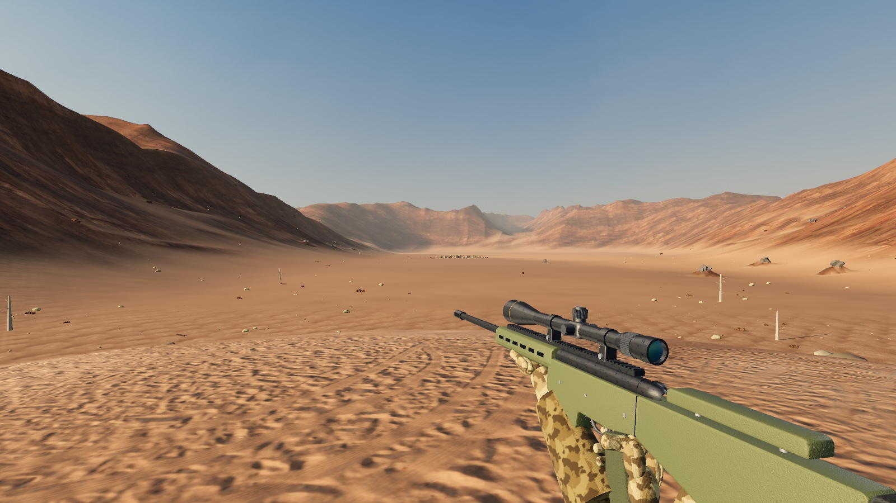

| Through the 25x scope | Training aids |
|---|---|
| 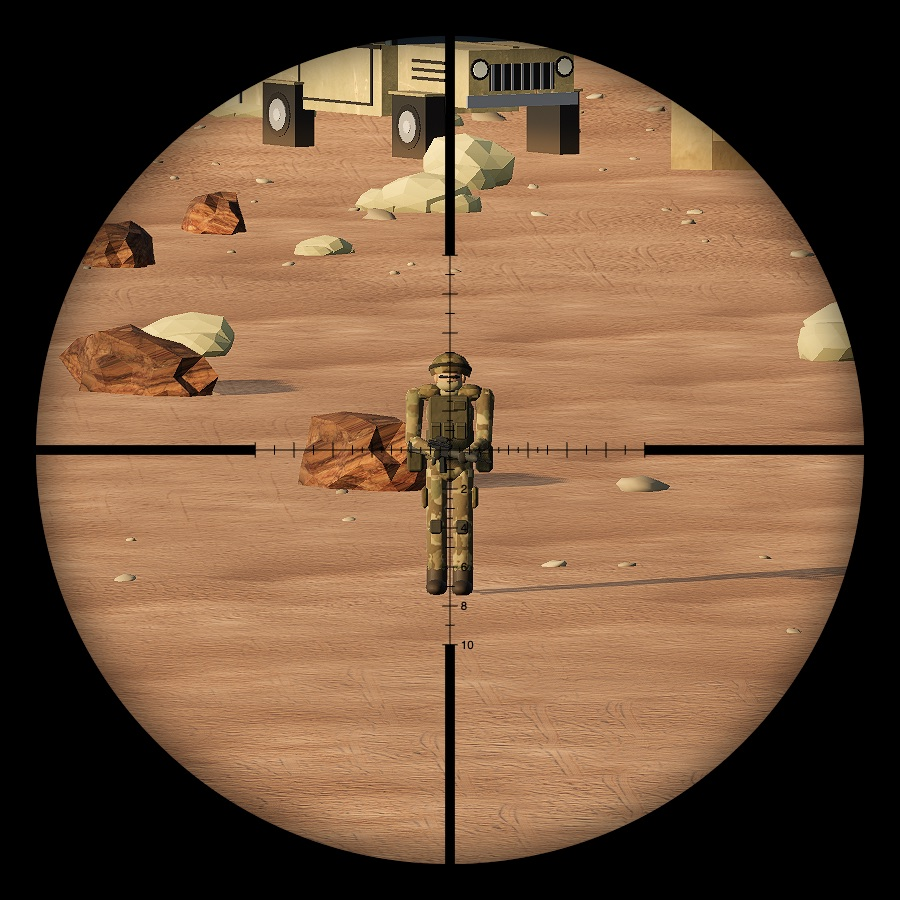 | 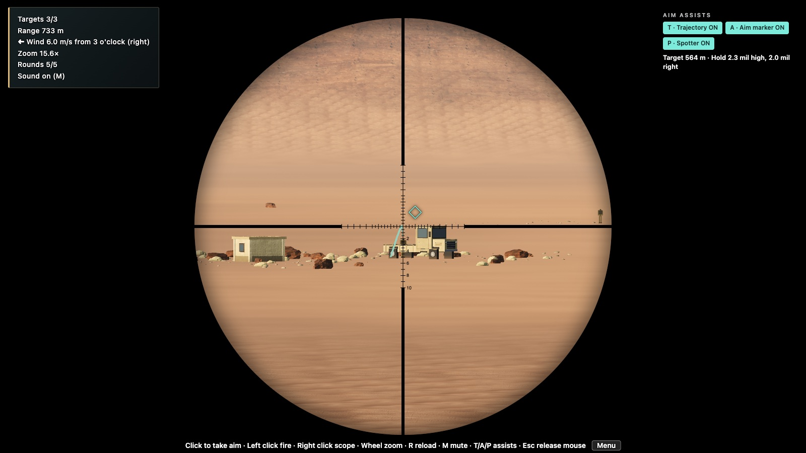 |
| **Green valley**, mountain position | **Arctic**, suppressed .338 |
| 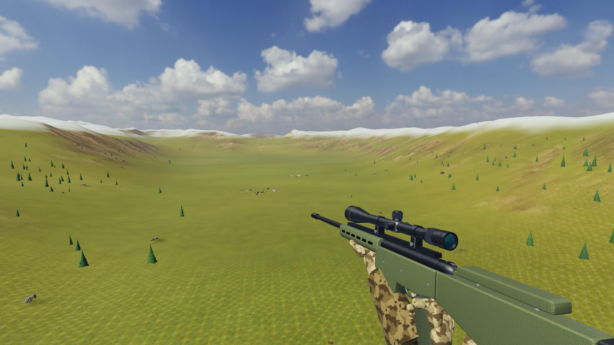 | 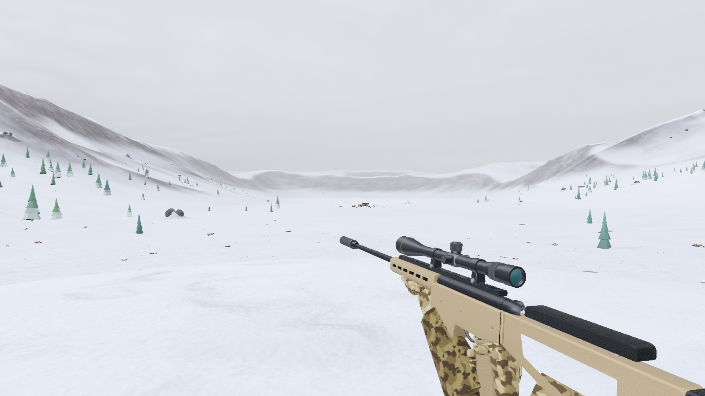 |

## Soldiers that fight back

Fire your first shot and the squad comes alive. They crouch, turn toward the sound and sprint for cover:

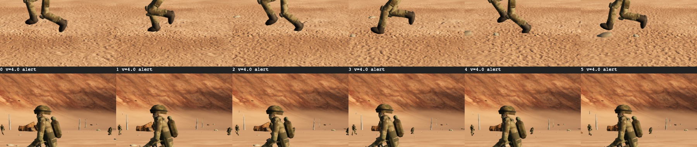

From behind walls and vehicles they rise, shoulder their rifles, fire a burst and drop back down:

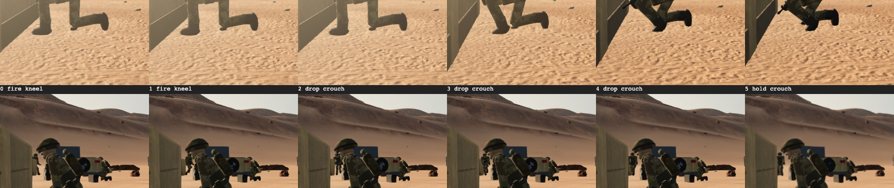

Through your scope you see the muzzle flash of the man who is shooting at you:

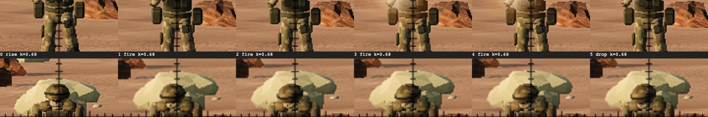

- **They have to find you first.** Each of your shots tells them a little more (less with a suppressor or a ghillie suit), and so does every bullet that cracks past one of them and every man that goes down. At first their bursts land far away; once they have you, they land close and hurt while you are exposed.
- **An enemy sniper who has you in his scope calls your position to them.** Take him out first.
- **They move.** After a near miss, when a friend close by goes down, or just after a while in one spot, they sprint to new cover, so you have to hunt them.
- **Mortars.** Once they have you well enough they call them in: you get a four-second warning to get into cover (**C**).
- Switch it off in the menu for a classic static range; the **Soldiers** slider sets how many there are (1 to 10).

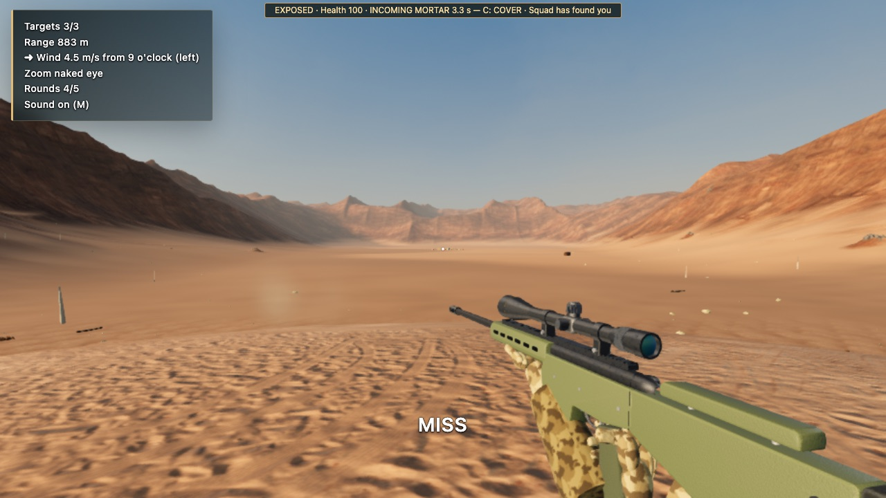

## Hits that look like hits

Bodies are not planks that tip over. A hit soldier goes limp: a Verlet ragdoll on his skeleton, pushed by the bullet, folds at the knees and waist and settles on the real terrain. Where you hit him decides how he falls (a head shot drops him on the spot, a chest shot staggers him back, a leg shot drops him onto that side), and a man hit at a sprint tumbles forward. The bullet goes through: a puff at the entry, a mist out of the far side, and the round flies on, slower, to kick up dust behind him.

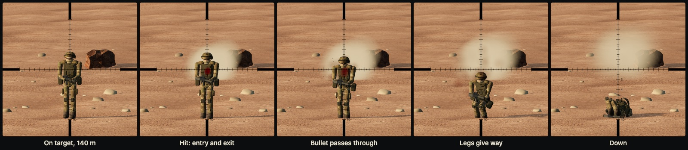

## High-value target

A mission type of its own: take down one officer before he gets away. The colonel wears a red beret and no helmet, so you can pick him out through the scope. He walks his compound with his hands behind his back, stops to talk to his men and heads for his jeep, so you have to lead him. Two to four bodyguards in black keep close to him, and his squad stands around.

Once they are alarmed, the guards close around him and rush him, crouching, to the jeep or a building. If they know which side the shot came from, they form a wall on that side. You have 15 to 30 s, depending on range, before he is gone.
- A head or chest hit kills him.
- A leg hit drops him to a limp at half speed, and a second hit finishes him.

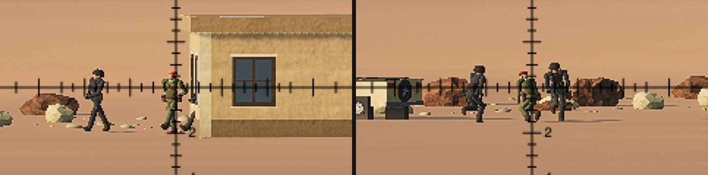

| Inside a military base | Down |
|---|---|
| 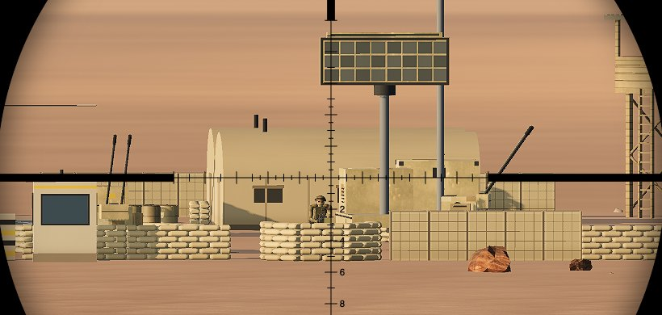 | 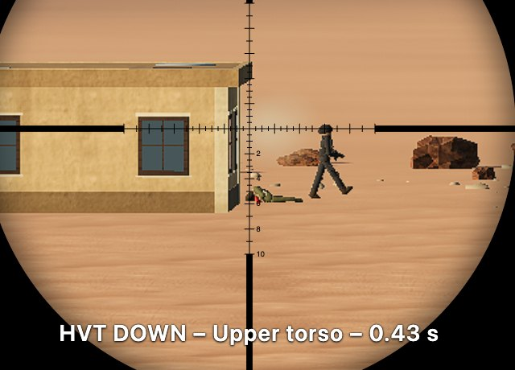 |

## The bullet outruns its sound

Nobody reacts to a shot before it reaches them: the enemy hears your shot only when the sound gets there.
- **The muzzle report** travels at the speed of sound in the map's air (about 1 s per 340 m) and tells them which side you are on. With a suppressor it is not heard at all beyond 200 m.
- **The crack** of a bullet that passes within 25 m tells them they are under fire, but not from where. A bullet only cracks while it is still faster than sound: a .308 is subsonic by about 1,200 m, and the 12.7x55 subsonic never cracks.
- **A man going down** near them is seen at once.

So a first supersonic shot can never be dodged. An unsuppressed subsonic round is the exception: its own report arrives before it does.

## Military base

An optional setting in the menu: none, an outpost (about 40 m across) or a full base (about 80 m).

What the base is built from:
- **The perimeter:** HESCO barriers, sandbag walls, a gate with a barrier arm, a guard booth and a chicane.
- **The base itself:** watch towers, machine-gun nests, tanks under camouflage nets, a howitzer line, cargo and fuel trucks, a helicopter on its pad, a radar, an anti-aircraft gun, ammo crates, tents, a generator, fuel drums, floodlights, a radio mast and a flag.

It is all procedural low-poly, coloured for each map, and a whole base costs 9 draw calls. What you see is what stops a bullet: sandbags and crates are soft cover, vehicles and guns are metal.

Guards stand at every post: on each tower deck, behind each machine gun, two at the gate, and patrols walking the inside of the perimeter. They are targets, and when the soldiers fight back they join the squad. In a high-value-target mission the colonel's walk runs through the base.

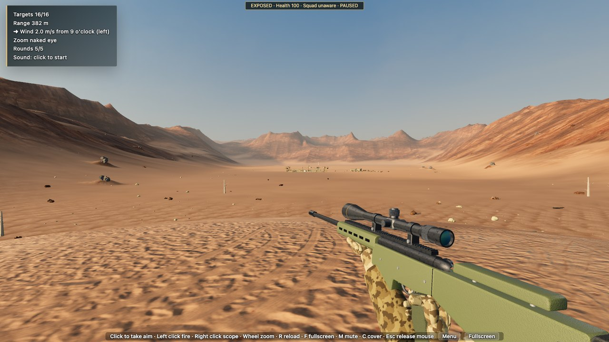

| The gate and its guards | Guards on the towers |
|---|---|
| 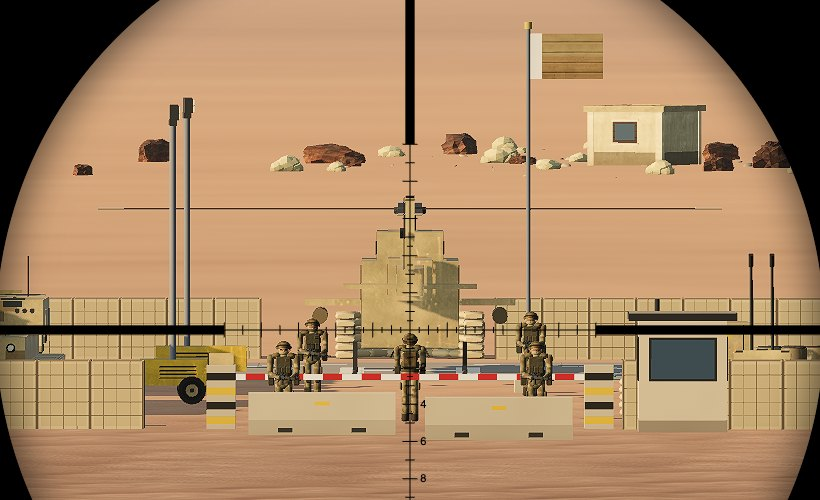 | 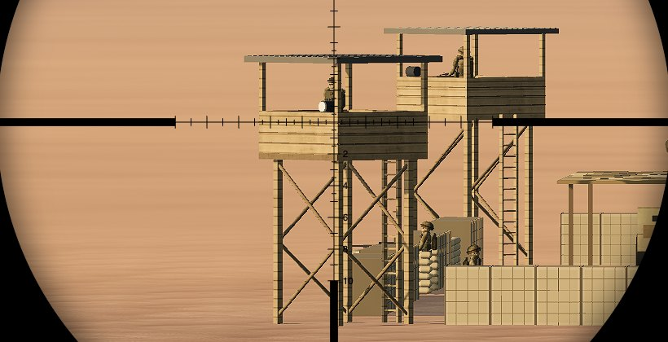 |

## Seven rifles

| | |
|---|---|
| 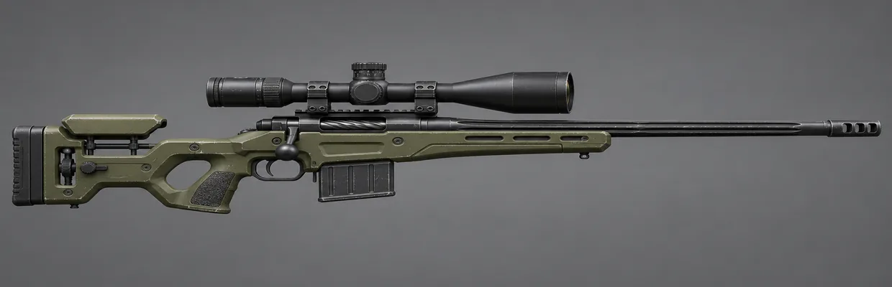 **.300 Win Mag** | 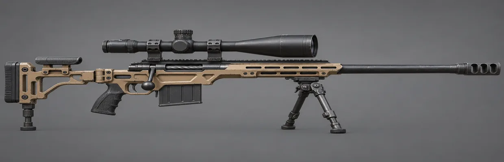 **.408**: a big brake, a long, high scope |
| 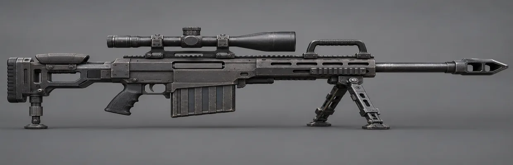 **.50 BMG**: semi-automatic, 10 rounds | 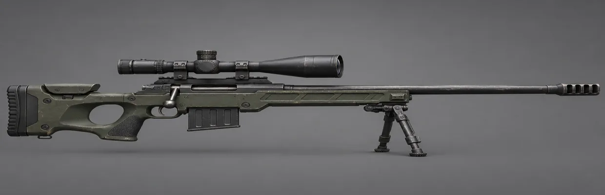 **12.7x108 mm**: a heavy bolt action |

Each rifle has its own model, report (the .50's is a deep boom with a long tail), bolt time, reload and recoil. The scope picture kicks with the shot, harder for the heavy calibres. Along with the original .308 and .338, the 12.7x55 mm subsonic is built round its suppressor: no crack, no flash, just a dull thump.

## Features

- **Real external ballistics**
  - A point-mass trajectory with G7 drag, integrated with RK4.
  - Air density and the speed of sound come from each map's temperature and pressure.
  - Bullet drop, wind drift and time of flight all emerge from the simulation; nothing is faked.
  - Checked against [js-ballistics](https://www.npmjs.com/package/js-ballistics) in the test suite.
- **Seven rifles, by calibre** (generic designs, each with its own model, report, bolt time, reload and recoil)
  - .308 Win: G7 BC 0.243 at 790 m/s.
  - .338 Lapua: G7 BC 0.322 at 900 m/s.
  - .300 Win Mag: G7 BC 0.31 at 869 m/s.
  - .408: G7 BC 0.47 (estimated) at 869 m/s, a big brake and a long, high scope.
  - .50 BMG: G7 BC 0.51 at 860 m/s, semi-automatic, 10 rounds.
  - 12.7x108 mm: G7 BC 0.42 (estimated) at 785 m/s, a heavy bolt action.
  - 12.7x55 mm subsonic: G7 BC 0.3 (estimated) at 295 m/s, built round its suppressor; its targets stay within 250 m, where the drop still fits the reticle.
  - The .50, .408 and 12.7x108 punch through vehicle bodies to the engine or the man behind, and any heavy round that goes through one man can down the next.
  - Each has an optional suppressor: no muzzle flash, a quieter report and slower detection.
- **5-25x scope** with a mil reticle, mouse-wheel zoom and a moving bolt. The picture is sharpened while you look through it, so a man at 600 m stays a man and not a smudge.
  - Sound travels at the speed of sound: at long range you hear the impact well after the shot.
- **Realistic enemies**: soldiers in camo with helmets, plate carriers, packs and rifles held in both hands; snipers prone in ghillie suits behind scoped rifles on bipods. Procedural models and textures, one draw call each.
- **Optional ghillie suit** (a switch in the menu)
  - While you hold fire the enemy cannot pick you out: lying still in plain view never builds more than 30 % detection.
  - Your sleeves wear the map's camouflage.
  - Your shots still give you away, though the muzzle report counts for less.

  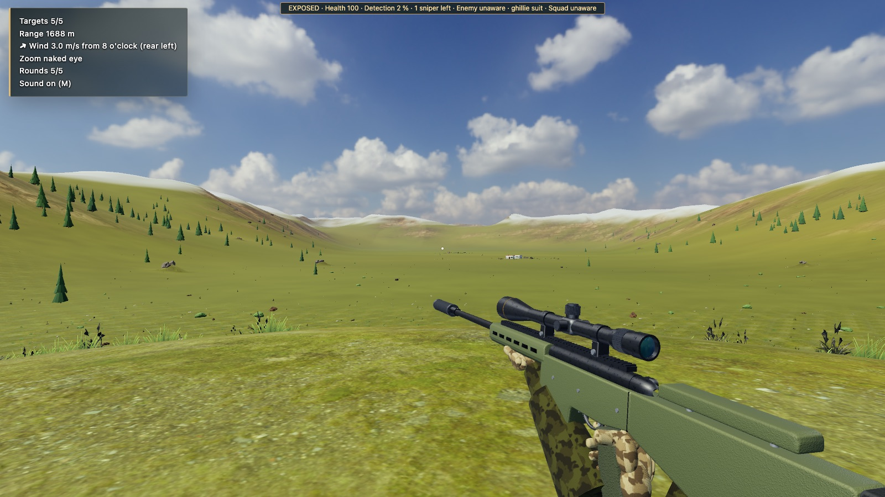
- **Enemy counter-snipers**
  - They start out unaware of you. Without a ghillie suit, a few seconds in the open is enough to make them search.
  - A shot gives you away twice: by the muzzle report, and by the crack and dust of the bullet, which point back at you when it ends near one of them. A suppressor only quiets the first.
  - Once they are searching their scopes narrow in on you and glint more often. Keep exposed and they find you, shoot back and call in bombardments.
  - They hide with some thought: every mission each one picks, from the spots that give him a clear shot at you, one that is well concealed (a backdrop behind him, hard cover close by, away from the soldiers, on a flank, sometimes a rooftop), so the hides change with the seed.
  - Press **C** to duck into cover.
- **Mission setup menu**
  - Three themes: desert, arctic and green valley.
  - A range band from 100 to 1,500 m.
  - 1 to 10 soldiers (that fight back, or stand still), vehicle targets, and 0 to 3 enemy snipers.
  - Wind speed and clock direction.
  - Firing position: valley floor, ridge or mountain top.
  - Density of buildings and scenery vehicles.
  - The objective: clear the area, or a high-value target.
  - A military base: none, an outpost or a full base.
  - Every mission is a shareable URL.
- **Optional training aids** (toggled with T, A and P): a live trajectory arc, an aim-point marker, and a spotter who calls the hold in mils.
- **Realistic rendering**
  - HDRI skies with image-based lighting and a triplanar PBR terrain.
  - Baked sun and ambient occlusion, plus instanced vegetation.
  - Bloom and colour grading.
  - Real recorded sounds.
- **Fullscreen** with **F** or the button on the menu and in the game.
- **Runs on modest GPUs**
  - Quality levels and dynamic resolution.
  - About 120 draw calls in the busiest mission.

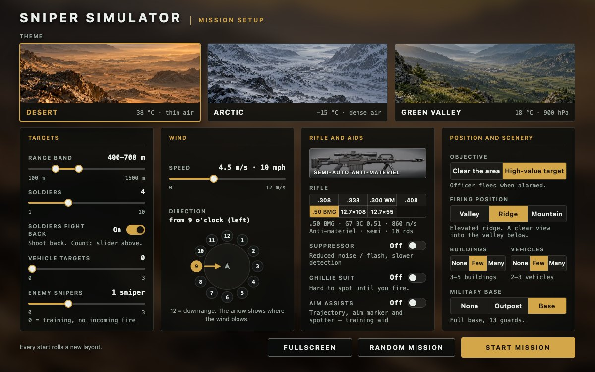

## Quick start

You need Node 22 or later.

```bash
git clone https://github.com/Anassedemnati/longshot-ballistics.git
cd longshot-ballistics
npm install
npm run dev
```

Open the URL Vite prints (usually http://localhost:5173), set up a mission and press **Start mission**.

## Controls

| Input | Action |
|---|---|
| Click | Take aim (locks the mouse) |
| Left click | Fire |
| Right click | Scope in / out |
| Mouse wheel | Zoom the scope |
| R | Reload |
| C | Duck into cover / come back up |
| T / A / P | Trajectory / aim marker / spotter (when training aids are on) |
| M | Mute |
| F | Fullscreen on / off (also a button on the start menu and in the in-game bar) |
| Esc | Release the mouse |

## URL options

| Parameter | Effect |
|---|---|
| `?m=v6.…` | A full mission, as written by the menu. The last two fields are the objective (`c` clear, `h` high-value target) and the military base (`n`, `o` outpost, `b` base). Copy it to share a mission. Older `v5.…` to `v1.…` links still open, with the newer options off. |
| `?quality=auto\|high\|medium\|low` | Render quality. `auto` (the default) is `medium` plus dynamic resolution. |
| `?post=low` | The cheapest post-processing: no bloom, no MSAA. |
| `?debug=1` | Exposes `window.__game`: `aimAt`, `fire`, `toggleScope`, `zoom`, `state()` and more. Used by the tests. |

## Development

```bash
npm test         # unit tests (Vitest): ballistics, mission logic, encounter rules, models
npm run build    # type-check and production build into dist/
npm run smoke    # build, then drive the game in headless Chrome and check it end to end
```

`npm run smoke` needs a local Google Chrome; it drives it through `playwright-core`.

### Project layout

| Folder | What lives there |
|---|---|
| `src/ballistics/` | G7 drag table, atmosphere, RK4 integrator, rifle data and trajectory solver. Pure TypeScript, no three.js. |
| `src/game/` | Weapon state, bullets in flight, hit tests, penetration, rangefinder, aim assists, the enemy-sniper encounter, the soldiers' squad brain (`squad.ts`), the HVT party (`hvt.ts`) and when a shot is heard (`hearing.ts`). |
| `src/mission/` | Mission config and URL codec, seeded layout of targets and props, the HVT compound and the military base planner (`basePlan.ts`), the game loop (`run.ts`). |
| `src/scene/` | Terrain and its material, HDRI sky, post-processing, vegetation, buildings, vehicles, soldiers. |
| `src/player/` | First-person view, input, scope reticle and the procedural rifle model. |
| `src/audio/` | Web Audio engine, recorded clips and sound-delay maths. |
| `src/ui/` | Mission menu, HUD, threat bar, results screen. |
| `src/fx/` | Dust, sparks, smoke, blood mist and the enemies' muzzle flashes. |
| `tests/` | Vitest suites, mirroring `src/`. |
| `scripts/` | The headless smoke test and visual-check tools. |

Gameplay rules, terrain and layout are seeded and pure, so they unit-test in Node without WebGL.

## Contributing

Issues and pull requests are welcome. Some ideas:
- more scenarios (convoy ambush, high-value target, defend a position);
- animated vehicle models;
- spin drift and Coriolis;
- ragdolls that collide with cover;
- mobile and touch controls.

Run `npm test` and `npm run smoke` before you open a PR.

## Credits

- **Textures, HDRI skies and 3D models:** [Poly Haven](https://polyhaven.com), CC0. See [`public/assets/CREDITS.md`](public/assets/CREDITS.md).
- **Sounds:** the Free Firearm Sound Library and freesound.org contributors, all CC0. See [`public/sounds/CREDITS.md`](public/sounds/CREDITS.md).
- **AI-generated images:** the menu artwork, the rifle reference sheet and the rifle art of the .300, .408, .50 and 12.7x108 (`public/references/rifle-<id>.webp`). Their prompts are stored next to the files. The 12.7x55's art is a render of the game's own model.
- **Libraries:** [three.js](https://threejs.org), [Vite](https://vite.dev) and [Vitest](https://vitest.dev).

## License

[MIT](LICENSE)
